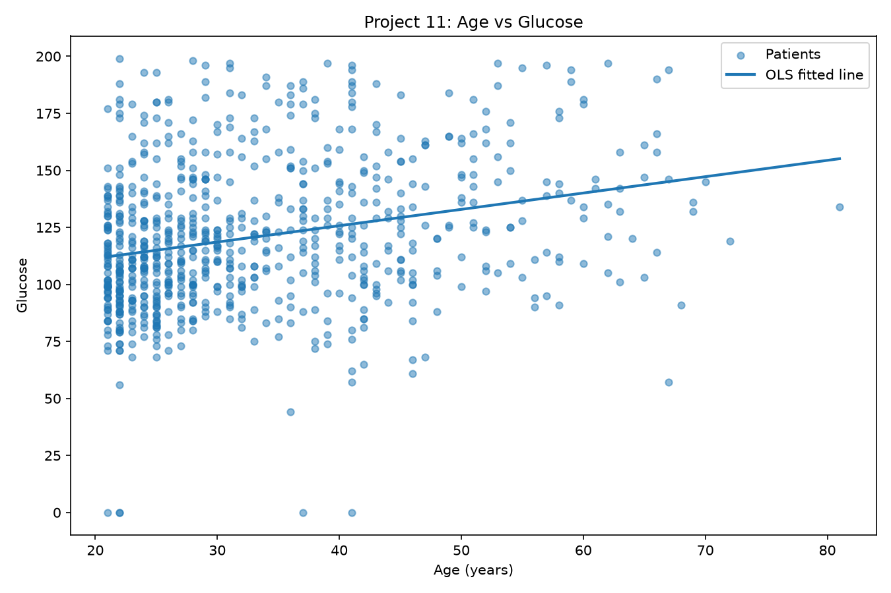
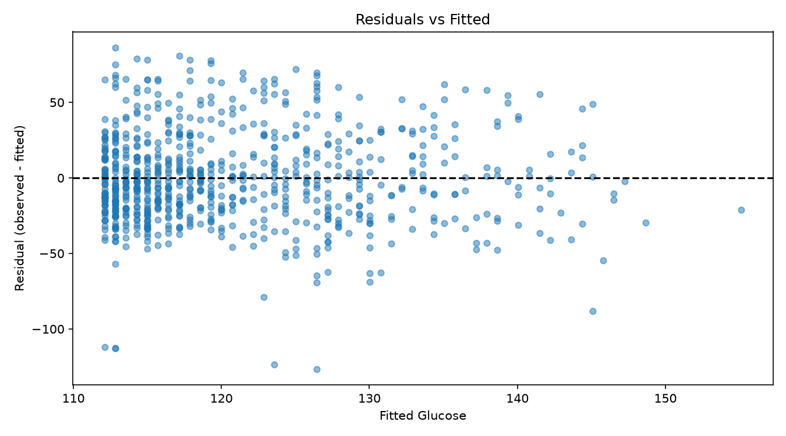
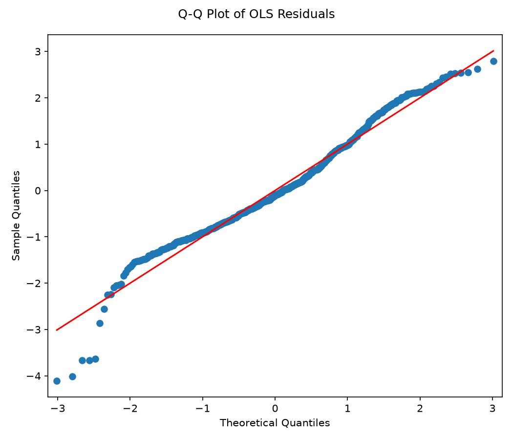
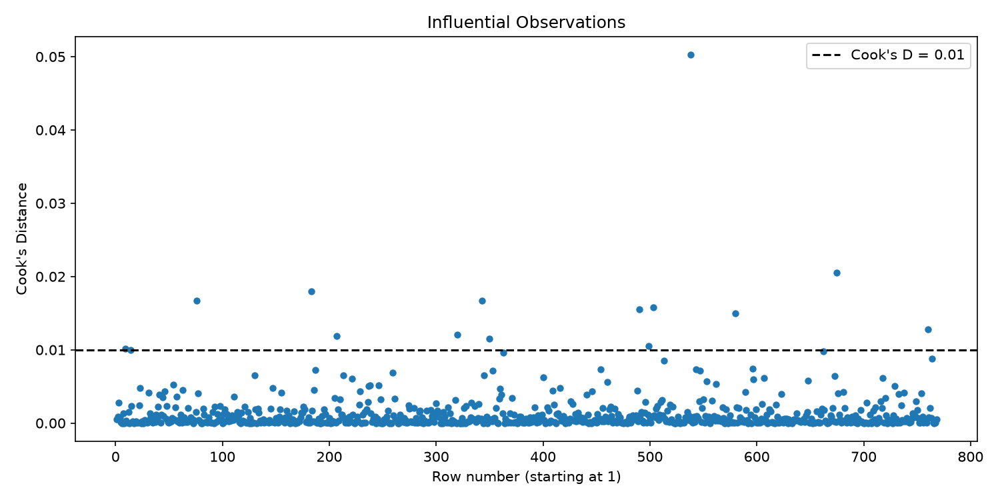

# Project 11: Correlation and Simple Linear Regression in Diabetes

## 1. Introduction

This project examines the relationship between Age (independent variable) and Glucose (dependent variable) in the Pima Indians Diabetes Dataset. The objectives are to measure covariance, Pearson and Spearman correlation, fit an ordinary least squares (OLS) regression, and examine model assumptions and influential observations.

## 2. Data and scatter plot

- Data source: https://raw.githubusercontent.com/jbrownlee/Datasets/master/pima-indians-diabetes.data.csv
- Number of observations used: **768**
- Predictor X: **Age**
- Response Y: **Glucose**
- Zero Glucose values retained in the raw data: **5**

The scatter plot shows individual Age/Glucose pairs and the OLS regression line. The line summarizes a **linear association**, not a causal relationship.

## 3. Covariance and correlation

| Statistic | Value | p-value |
| --- | --- | --- |
| Sample covariance | 99.0828 | Not applicable |
| Pearson r | 0.2635 | 1.150e-13 |
| Spearman rho | 0.2850 | 8.000e-16 |

**Interpretation:** The Pearson coefficient indicates **a weak positive linear association**. Pearson measures linear association between numerical variables, while Spearman measures monotonic association using ranks. Both can be statistically tested; neither proves causation. Descriptive strength labels are approximate conventions, not fixed clinical rules.

## 4. Simple linear regression (OLS)

The mathematical model is:

`Glucose_i = beta0 + beta1 * Age_i + error_i`

The fitted prediction equation is:

`Predicted Glucose = 97.0802 + (0.7164) * Age`

| Measure | Result |
| --- | --- |
| Intercept (beta0) | 97.0802 |
| 95% CI, intercept | [90.5217, 103.6387] |
| Slope for Age (beta1) | 0.7164 |
| 95% CI, Age slope | [0.5304, 0.9024] |
| Age coefficient p-value | 1.150e-13 |
| R-squared | 0.0694 (6.94%) |
| Adjusted R-squared | 0.0682 |

**Slope interpretation:** An additional year of age is associated with an estimated **0.7164-unit** change in Glucose on average in this simple linear model. The Age slope is **statistically significant** at alpha = 0.05.

**R-squared interpretation:** Age explains approximately **6.94%** of the variation in Glucose *within this sample and linear model*. R-squared is not the probability a person has diabetes, does not establish causality, and does not measure predictive accuracy on new data by itself.

The complete statsmodels OLS output is saved in `project11_ols_summary.txt`.

## 5. Residual diagnostics

A residual is `Observed Glucose - Predicted Glucose`. A useful residual-versus-fitted plot has no clear systematic curve or changing spread; a funnel may suggest non-constant variance, and a curve may suggest nonlinearity.

Breusch-Pagan p-value: **0.11689**. This provides **no strong statistical evidence against constant residual variance** at alpha = 0.05. The residual plot should also be inspected visually.

A Q-Q plot close to its reference line is consistent with approximately normal residuals. Jarque-Bera p-value: **2.810e-06**, providing **evidence against normally distributed residuals** at alpha = 0.05. With a large sample, even relatively small departures can be detected. Statistical tests and visual checks should be interpreted together.

## 6. Cook's Distance and influential observations

Cook's Distance describes how much the fitted regression may change if one observation is removed.

The assignment-defined flag is `Cook's D > 0.01`.

- Number above 0.01: **14**
- Largest Cook's D: **0.05026**

Five largest values:

| Row | Age | Glucose | Cook's D |
| --- | --- | --- | --- |
| 538 | 67 | 57.0 | 0.05026 |
| 675 | 68 | 91.0 | 0.02052 |
| 183 | 21 | 0.0 | 0.01801 |
| 76 | 22 | 0.0 | 0.01675 |
| 343 | 22 | 0.0 | 0.01675 |

Flagged observations require investigation; they should not automatically be removed. The complete table is saved as `project11_cooks_distance.csv`.

## 7. Answers to analytical questions

1. **Direction and strength:** Age and Glucose show a weak positive linear association (Pearson r = 0.2635).
2. **Pearson vs Spearman:** Pearson quantifies a linear relationship using original values; Spearman quantifies a monotonic relationship using ranked values.
3. **Slope:** Each additional year of Age is associated with an average change of 0.7164 Glucose units according to this simple model.
4. **R-squared:** R-squared = 0.0694 is the proportion of sample Glucose variation explained by a linear Age predictor; it does not prove causation or guarantee good prediction for new patients.
5. **Causality:** A statistically significant Age coefficient does **not** prove Age causes Glucose to change. This is an observational analysis.
6. **Residual plot:** It is used to look for curvature, unequal spread (heteroscedasticity), outliers, and other structure. Here, the Breusch-Pagan test gives p = 0.11689; visually inspect `residuals_vs_fitted.png` before making a stronger claim.
7. **Normality:** The Q-Q plot and Jarque-Bera test assess residual normality. Jarque-Bera p = 2.810e-06; this indicates evidence against normally distributed residuals, rather than guaranteeing perfect normality/non-normality.
8. **Influential observations:** **14** observations have Cook's D > 0.01.

## 8. Clinical interpretation and limitations

These associations describe the observed dataset, not a treatment effect or a causal effect of aging. Other factors (BMI, pregnancy history, medications, lifestyle and selection effects) may contribute to Glucose values. The analysis uses the assignment's raw data, including **5** Glucose entries equal to zero, which are clinically suspicious and can affect coefficients and diagnostics. No rule for handling them was supplied by the assignment, so they were not silently changed.

Observations may not represent all populations, and OLS assumes an adequately specified mean relationship and appropriate error conditions. Out-of-sample predictive ability was not evaluated.

## 9. Conclusion

The project measured correlation between Age and Glucose, fitted a simple OLS regression, reported a 95% confidence interval for the slope and R-squared, examined residual diagnostics, and counted observations with Cook's D > 0.01. Results indicate **a weak positive linear association**, with important limitations for clinical and causal interpretation.
