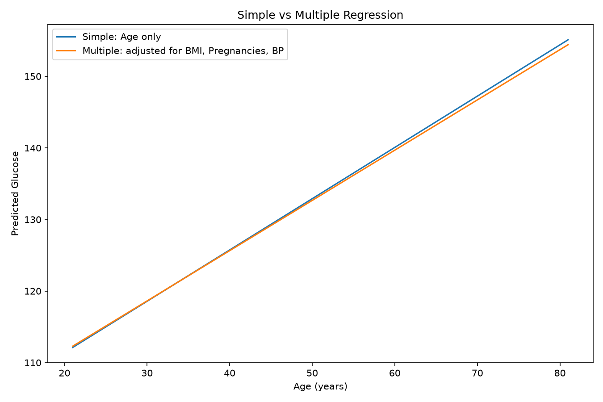
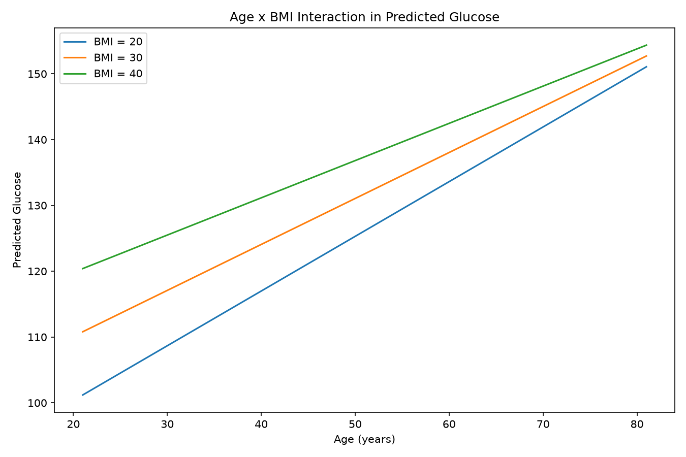
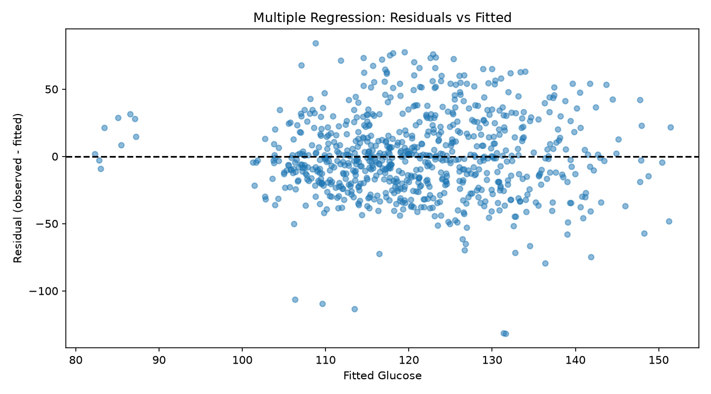
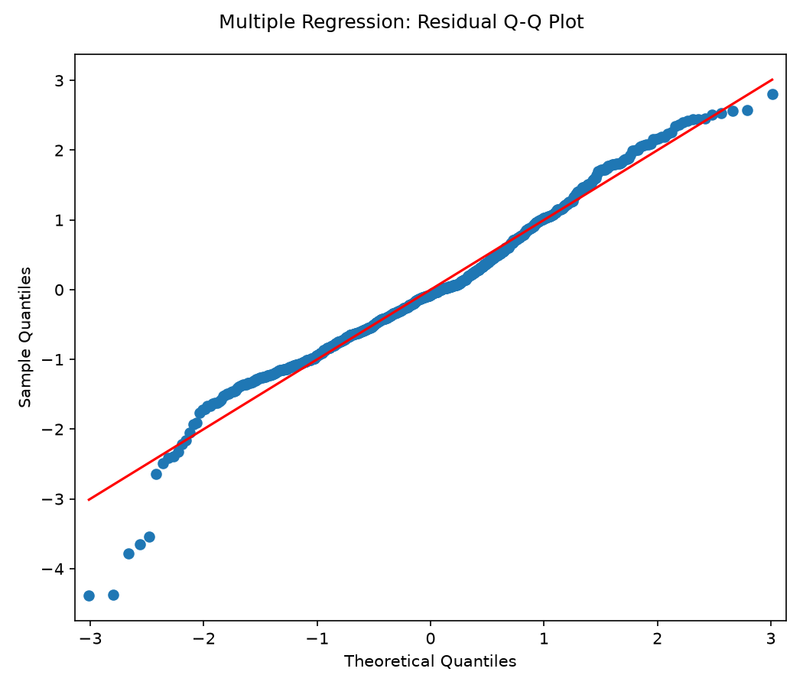

# Project 12: Multiple Regression and Confounding in Diabetes

## 1. Introduction

This project uses the Pima Indians Diabetes Dataset to study the relationship between Age and Glucose while adjusting for BMI, number of Pregnancies and BloodPressure. The study also checks multicollinearity with VIF and investigates an Age x BMI interaction.

- Data source: https://raw.githubusercontent.com/jbrownlee/Datasets/master/pima-indians-diabetes.data.csv
- Complete-case observations used in every model: **768**
- Outcome / dependent variable: **Glucose**, not diabetes diagnosis.

## 2. Simple regression (Age only)

Mathematical model:

`Glucose_i = beta0 + beta1 * Age_i + error_i`

Fitted model:

`Predicted Glucose = 97.0802 + (0.7164) * Age`

- Age coefficient: **0.7164**
- Age coefficient 95% CI: **[0.5304, 0.9024]**
- Age coefficient p-value: **1.150e-13**
- R-squared: **0.0694**

## 3. Multiple regression

Mathematical model:

`Glucose_i = beta0 + beta1*Age_i + beta2*BMI_i + beta3*Pregnancies_i + beta4*BloodPressure_i + error_i`

Coefficient results:

| Term | Coefficient | 95% CI | p-value |
| --- | --- | --- | --- |
| const | 67.9226 | [56.4798, 79.3653] | 5.393e-29 |
| Age | 0.7020 | [0.4811, 0.9230] | 7.363e-10 |
| BMI | 0.8180 | [0.5354, 1.1007] | 1.896e-08 |
| Pregnancies | -0.1884 | [-0.9444, 0.5677] | 0.62489 |
| BloodPressure | 0.0606 | [-0.0579, 0.1791] | 0.31564 |

- R-squared: **0.1157**
- Adjusted R-squared: **0.1110**

**Interpretation of BMI:** Holding Age, Pregnancies, and BloodPressure constant, a one-unit increase in BMI is associated with **0.8180** units of difference in predicted Glucose, on average. This is an adjusted association, not a causal effect.

Full model summaries: `project12_simple_summary.txt`, `project12_multiple_summary.txt` and `project12_interaction_summary.txt`.

## 4. Comparing simple and multiple regression

| Model | Age slope | R-squared | Adj. R-squared |
| --- | --- | --- | --- |
| Simple | 0.7164 | 0.0694 | 0.0682 |
| Multiple | 0.7020 | 0.1157 | 0.1110 |
| Interaction | 1.0965 | 0.1172 | 0.1114 |

- Simple Age coefficient: **0.7164**
- Adjusted (multiple-regression) Age coefficient: **0.7020**
- Change in the Age coefficient: **-0.0144**
- Relative change vs the simple coefficient: **-2.01%**

**Interpretation:** The Age coefficient changes because the adjusted model also accounts for BMI, Pregnancies and BloodPressure. These variables can be correlated with both Age and Glucose. A coefficient change is compatible with confounding or shared variation, but it **does not by itself prove confounding or a causal effect**. The two models answer different conditional questions.

## 5. Multicollinearity and VIF

Variance Inflation Factor (VIF) measures how strongly a predictor can be explained by the other predictors in the model. Larger VIF values indicate more multicollinearity.

| Predictor | VIF |
| --- | --- |
| Age | 1.4787 |
| BMI | 1.0875 |
| Pregnancies | 1.4214 |
| BloodPressure | 1.1524 |

**Interpretation:** All predictor VIFs are below 5, so there is no strong VIF-based warning of serious multicollinearity in this model. The cutoffs 5 and 10 are common practical guidelines rather than universal laws. VIF is calculated for the four predictors in the multiple model, excluding the intercept.

## 6. Age x BMI interaction

A new column is constructed:

`Age_BMI = Age * BMI`

Interaction model:

`Glucose_i = beta0 + beta1*Age_i + beta2*BMI_i + beta3*Pregnancies_i + beta4*BloodPressure_i + beta5*(Age_i*BMI_i) + error_i`

- Age x BMI coefficient (beta5): **-0.013265**
- 95% CI for interaction coefficient: **[-0.036237, 0.009707]**
- Interaction p-value: **0.25733**
- Interaction model R-squared: **0.1172**

**Result:** The Age x BMI interaction is not statistically significant at alpha = 0.05; this does not prove that the interaction is exactly zero.

With this raw (not centered) Age x BMI product, the conditional Age slope depends on BMI:

`Age slope at a given BMI = beta1 + beta5 * BMI`

| BMI | Estimated Age slope (interaction model) |
| --- | --- |
| 20 | 0.8312 |
| 30 | 0.6985 |
| 40 | 0.5659 |

The figure shows predicted Glucose across Age at BMI = 20, 30 and 40, while Pregnancies and BloodPressure are held at their **sample means** (3.85 and 69.11, respectively). These are model predictions, not actual patient trajectories. In the interaction model, the standalone Age coefficient describes the slope at BMI = 0; this is not a meaningful clinical reference and should not be interpreted alone.

## 7. Residual checks for the multiple regression

A residuals-versus-fitted plot helps identify nonlinearity, unequal residual spread, unusual observations, and possible model misspecification. Breusch-Pagan p-value: **0.01963**, suggesting **evidence of non-constant variance (heteroscedasticity)** at alpha = 0.05. Visual inspection is still needed.

The Q-Q plot examines whether residuals approximately follow a Normal distribution. Jarque-Bera p-value: **2.974e-09**; this provides **evidence against normally distributed residuals** at alpha = 0.05. A test result alone does not establish perfect model assumptions.

## 8. Answers to analytical questions

1. **Age coefficients:** Simple model = 0.7164; multiple model = 0.7020; change = -0.0144.
2. **Why the change?** The multiple model adjusts for BMI, Pregnancies and BloodPressure. Correlations among predictors and outcome can shift the conditional Age coefficient; this alone does not prove confounding.
3. **BMI effect holding other variables constant:** +1 BMI unit corresponds to 0.8180 predicted Glucose units with Age, Pregnancies and BloodPressure fixed.
4. **What is VIF?** A measure of variance inflation in an estimated coefficient caused by relationships among predictors.
5. **Severe multicollinearity?** Maximum VIF = 1.4787. All predictor VIFs are below 5, so there is no strong VIF-based warning of serious multicollinearity in this model.
6. **Age x BMI interaction:** Coefficient = -0.013265, p = 0.25733. The Age x BMI interaction is not statistically significant at alpha = 0.05; this does not prove that the interaction is exactly zero. It tests whether the association of Age with Glucose changes with BMI; it does not imply a biological mechanism.
7. **Why not causation?** OLS on observational data may be affected by unmeasured confounding, selection bias, measurement problems, misspecified relationships and reverse causality.
8. **Which variables were adjusted for?** BMI, Pregnancies and BloodPressure were included as candidate confounders. Whether each is a true confounder depends on subject-matter and causal assumptions; statistical adjustment alone is not proof.

## 9. Clinical interpretation and limitations

The models describe **Glucose**, not the probability of diabetes or a clinical diagnosis. These estimates are associations in the observed sample. Raw zero values were retained because the assignment did not specify a data-cleaning rule; zero counts: Glucose = 5, BMI = 11, BloodPressure = 35. These entries may be clinically implausible and may affect results.

Residual assumptions should be checked, and VIF only evaluates linear dependencies among included predictors. No external validation, cross-validation, nonlinear Age modeling or causal identification strategy was conducted. The sample may not generalize to every population.

## 10. Conclusion

The analysis compares an Age-only regression with an adjusted model using Age, BMI, Pregnancies and BloodPressure. It reports age-coefficient changes, the R-squared of each model, VIF scores, an Age x BMI interaction, and residual diagnostics. Associations and statistical significance should not be interpreted as proof of causality.
